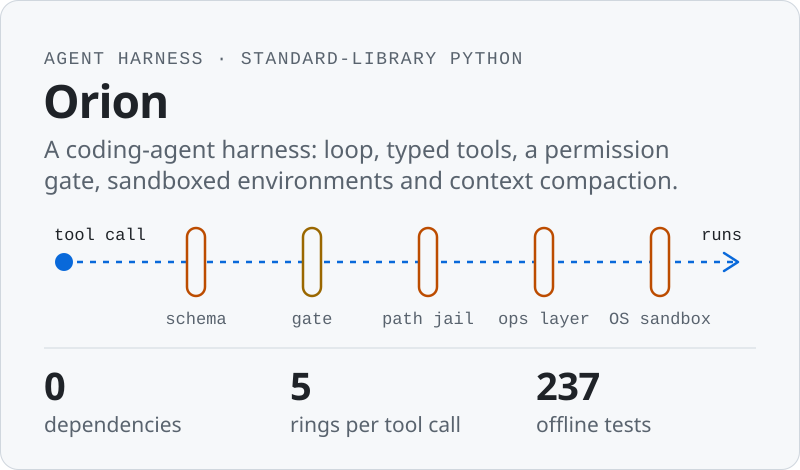

<picture>
  <source media="(prefers-color-scheme: dark)" srcset="docs/images/orion-dark.svg">
  
</picture>

# Orion

A minimal coding-agent harness in pure Python: standard library only, Python 3.10+, no dependencies. It gives a model a loop, typed tools and a sandbox, and keeps a long task inside a finite context window.

It is built to answer two questions: **what can the agent touch**, and **when it is wrong, what is the worst that happens?**

## Quick start

```sh
git clone https://github.com/Deepanshu-Mehta/Orion-Harness && cd Orion-Harness
python3 -m unittest discover -s tests          # 237 tests, no API key or network
export GEMINI_API_KEY=...                       # or ORION_API_KEY
python3 demos/day2_build.py --env sandbox --mode auto --headless \
  "Create fib.py with an iterative fib(n) and a __main__ that prints fib(30); run it"
```

Docker and SSH tests are skipped unless enabled with `ORION_TEST_DOCKER=1` or `ORION_TEST_SSH=host:/abs/path`.

## How it is built

Five layers, each added on its own day, each a small set of files:

| Layer | What it adds | Code |
|---|---|---|
| 1. Loop | The model client (the only file that knows the vendor) and the agent loop | `orion/provider.py`, `orion/loop.py` |
| 2. Tools | Environments that decide where tools run, typed tools, and a permission gate | `orion/env/`, `orion/tools/`, `orion/security/` |
| 3. Context | An assembled system prompt, memory and skills, and a context engine that prunes and summarizes | `orion/prompt.py`, `orion/memory.py`, `orion/skills.py`, `orion/context/` |
| 4. Durability | Next | |
| 5. Orchestration | Next | |

The tools are `read_file`, `list_files`, `grep`, `write_file`, `edit_file`, `bash` and `background_job`, plus `remember`, `use_skill`, and opt-in web search and fetch.

## Security: five rings

Every tool call passes five rings. The gate decides *whether* a call runs; the environment decides *where* it runs and how far a mistake can reach.

```
tool call ──► [1 schema validation]  bad arguments never reach code
          ──► [2 the gate]           hard-deny rules, protected paths, the mode dial, a human approver
          ──► [3 path jail]          every path lands inside the workspace root
          ──► [4 operations]         where the tool actually runs
          ──► [5 OS isolation]       sandbox, container or remote host: bounds what a miss can cost
```

- **Modes:** `read-only`, `ask` (the default), `accept-edits` and `auto` (alias `yolo`). `auto` refuses to run without isolation.
- **Environments:** `local`, `sandbox` (macOS seatbelt, Linux bubblewrap), `docker` / `docker:<image>`, and `ssh:<host>:<abs_root>`.
- **Protected paths:** secrets such as `.env`, keys and `~/.ssh` never enter the context, and the agent can never rewrite its own policy.
- **Known leaks:** pattern rules cannot see through variables, scripts the agent writes and then runs, or prompt injection that leads to an allowed call. That is why isolation, not the rules, is the boundary Orion relies on.

[docs/security.md](docs/security.md) has the full mode table, what each environment does and does not protect, and every known leak.

## Context: fitting a long task in a finite window

```
SYSTEM PROMPT  assembled once, stable to volatile, never compacted
  identity + rules ─► environment ─► AGENTS.md / CLAUDE.md ─► skills ─► memory ─► date
TAPE           grows, managed by the context engine
  [first user message, verbatim]
  [compaction summary, updated in place]
  [recent tail, verbatim]
```

When the tape grows too large, old tool output is pruned first (no model call), and only then is the middle summarized (one call). A failed summary never drops history. Project instructions come from `AGENTS.md` or `CLAUDE.md`, skills from `.orion/skills/<name>/SKILL.md`, and memory from `.orion/memory.md`. Orion relies on Gemini's implicit prefix caching rather than explicit caches. See [docs/context.md](docs/context.md).

## Demos

Set `ORION_API_KEY` or `GEMINI_API_KEY` (and optionally `ORION_MODEL`) first. To use DeepSeek, set `DEEPSEEK_API_KEY` and `ORION_MODEL=deepseek-v4-pro` (or `deepseek-flash`). `ORION_COMPACT_MODEL` picks a separate, cheaper model for summaries. `web_search` always uses Gemini.

```sh
# Layer 1: one tool, one loop
python3 demos/day1_dice.py --trace

# Layer 2: interactive approvals on your machine (the default mode is "ask")
python3 demos/day2_build.py --env local "Add a README to this project"

# Layer 2: read-only tour of a repository
python3 demos/day2_build.py --env local --mode read-only --workdir . "Explain what this repository does"

# Layer 2: web tools are opt-in
python3 demos/day2_build.py --env sandbox --mode auto --headless --web \
  "What is the latest stable Python version? Cite the source."

# Layer 3: compaction on a small task; --compact-headroom N compacts at overhead + N tokens
python3 demos/day3_context.py --env sandbox --mode auto --headless --compact-headroom 2500 --show-summary \
  "Create five files one.txt through five.txt, then MANIFEST.md listing each file's line count"
```

Without `--workdir`, each run gets a fresh directory under `./scratch/`.

## License

[MIT](LICENSE)
